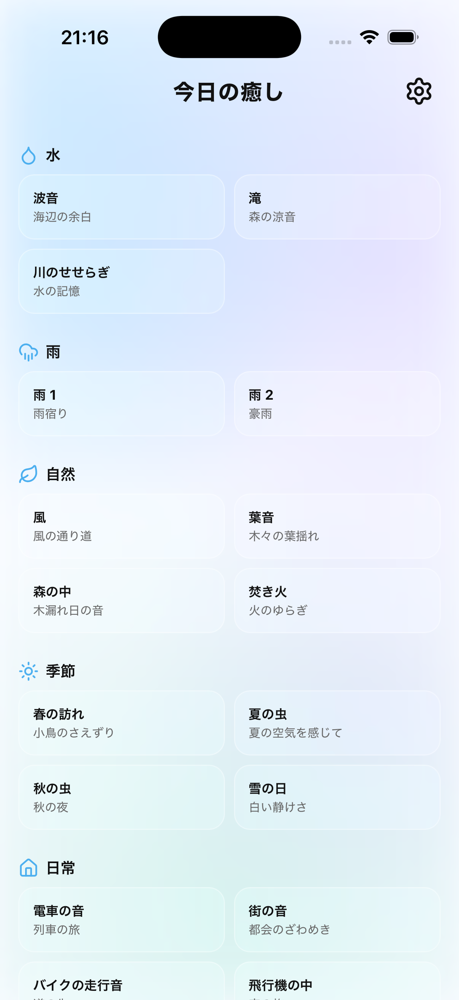
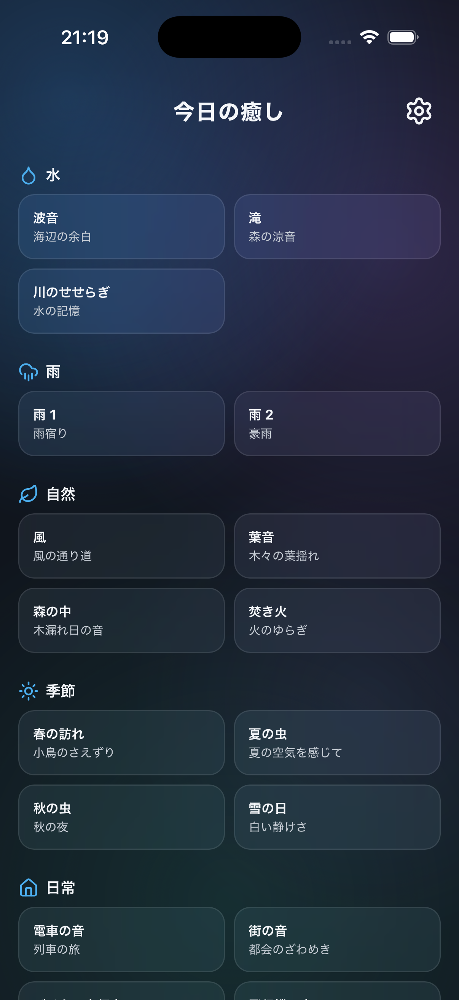
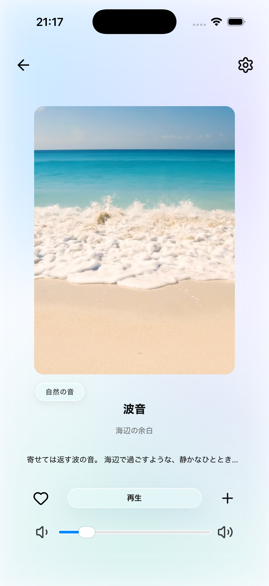
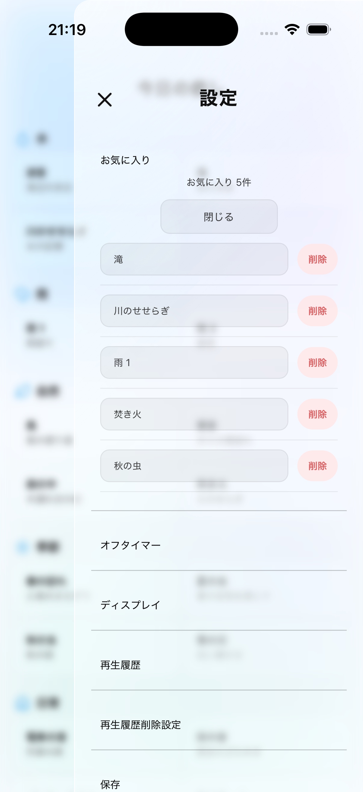
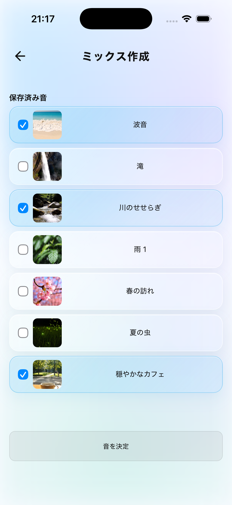
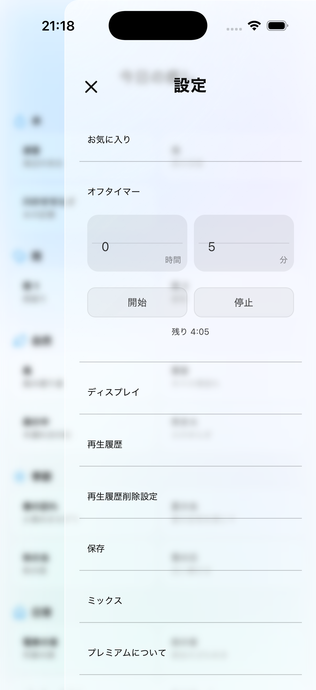
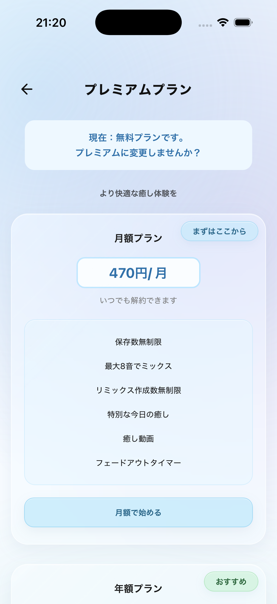

Būte Sleep Sounds
アプリ名：今日の癒し

自然音や環境音を通じて、日常のさまざまなシーンでリラックスできる時間を提供するアプリです。
複数の音源を自由に組み合わせるミックス機能などを備え、自分好みの音環境を作成できることを特徴としています。

1. アプリ画面

### ホーム画面（ライトモード）
水・自然・日常などのカテゴリごとに音源を整理し、好みの環境音を直感的に探して再生できます。

### ホーム画面（ダークモード）
ライトモードとダークモードに対応し、利用する時間帯や好みに合わせて画面の表示を切り替えられます。

### 音声再生画面
音源ごとの画像や説明を表示し、再生・一時停止・音量調整などの操作をシンプルに行えます。

### お気に入り画面
気に入った音源をお気に入りに登録し、いつでも一覧から選んで再生できます。

### ミックス作成画面
複数の音源を自由に組み合わせ、自分好みの環境音を作成できます。

### タイマー機能
再生を停止する時間を1分単位で設定でき、就寝時やリラックスタイムにも利用できます。

### プレミアム・利用情報
プレミアムプランの内容や利用できる機能を確認し、無料プランからのアップグレードを選択できます。

### 利用規約・プライバシー画面
アプリの利用規約やプライバシーポリシーなど、利用者が安心して使うために必要な情報を確認できます。

2. 開発背景・目的

日常のリラックスタイムや就寝時など、さまざまな場面で気軽に環境音を楽しめるアプリを目指して開発しました。
音声再生やタイマー、お気に入り、ミックス作成などの機能を実装し、利用者が自分に合った音環境を作れることを重視しています。
現在は、アプリ内課金・広告機能の実機での動作確認と、一般公開に向けた準備を進めています。

3. 使用技術

* HTML
* CSS
* JavaScript
* Vite
* Capacitor

4. 利用サービス・開発ツール

* Visual Studio Code：開発環境
* GitHub：ソースコード管理・関連ページの公開
* RevenueCat：アプリ内課金の管理
* Google AdMob：アプリ内広告の配信

※アプリ内課金・広告機能は導入および動作確認を進めています。

5. 実装済み機能

  音声再生機能

* 音源一覧から任意の音源を選択して再生
* 再生・一時停止の操作
* 音量調整
* バックグラウンド再生
* アプリ画面を閉じた状態での音声再生
* カテゴリ別の音源表示

  カスタマイズ機能

* タイマー機能：1分単位で再生停止時間を設定し、設定時間経過後に音声を自動停止
* お気に入り機能：好きな音源を登録し、いつでも利用できるように管理
* 音源保存機能：音源をアプリ内に保存し、ミックス作成時に利用可能
* ミックス作成機能：複数の音源を組み合わせ、自分好みの音環境を作成

  動画再生機能

* プレミアムプラン向けの動画コンテンツ再生

  無料・プレミアムプラン

* 無料プランとプレミアムプランの区分け
* プレミアムプラン限定コンテンツの設定
* プレミアムプラン向けの課金画面
* RevenueCatを利用したアプリ内課金機能の導入（実機での購入・復元動作を確認中）

  アプリ内の案内機能

* 利用規約の表示
* プライバシーポリシーの表示
* お問い合わせ先の案内

6. 技術的な工夫・取り組み

  直感的に操作できるUI・UXの設計

* スマートフォンでの操作を前提に、ボタンの配置や画面構成を調整
* ユーザーが目的の機能を見つけやすいよう、画面のわかりやすさと操作性を重視
* 前の画面に戻る操作について、ボタン操作だけでなくスワイプ操作にも対応
* ライトモード・ダークモードの両方で視認性を確保できるよう、文字色や配色を調整
* アプリアイコンや画面全体のデザインに統一感を持たせるよう工夫

  音声・動画コンテンツの品質向上

* 音源の音質やノイズの有無を確認し、快適に聴ける音声を目指して調整
* 動画のループ再生時に、映像の切り替わりが不自然にならないよう、つなぎ目の自然さを重視
* 音源ごとの特徴に合わせてタイトルや説明文を考案し、ユーザーが内容や雰囲気を把握しやすいよう工夫

  ユーザーの利用シーンを考慮した機能設計

* タイマーやお気に入り機能など、ユーザーの利用方法に合わせて音を楽しめる機能を実装
* 複数の音源を組み合わせ、自分好みの音環境を作成できるミックス機能を実装
* バックグラウンド再生に対応し、ほかの操作をしながらでも音声を楽しめるよう設計

  公開・運営を見据えた準備

* アプリ内から利用規約やプライバシーポリシーを確認できるよう実装
* お問い合わせ先を案内し、ユーザーが必要な情報を確認できる構成に整備
* 無料プランとプレミアムプランを区分し、提供する機能やコンテンツを整理

7. 開発状況

iOS版をTestFlightで動作確認中です。

主要機能の実装を進め、実機での動作確認を通じて操作性や表示、音声・動画コンテンツの品質改善に取り組んでいます。
現在は、アプリ内課金・広告機能の最終確認と、一般公開に向けた準備を進めています。

8. 今後の対応予定

* RevenueCatを利用したアプリ内課金の購入・復元処理の最終確認
* AdMobによる広告表示および広告関連設定の確認
* TestFlightでの最終的な動作確認と、必要に応じた不具合修正
* ストア掲載情報や必要な申請情報の整備
* 公開前の最終確認およびストアへの申請

9. 改善への取り組み

開発中は、実際にアプリを操作しながら表示や動作を確認し、使いやすさと品質の向上に取り組みました。

* UIの改善： ボタンの配置や画面構成を見直し、操作のわかりやすさを改善
* 操作性の改善： 画面遷移や戻る操作を見直し、スワイプ操作にも対応
* 表示の改善： iPhoneでの表示崩れや、ライトモード・ダークモードでの文字色の問題を修正
* 再生機能の改善： 音声再生に関する不具合を修正し、安定した再生を目指して調整
* アイコン表示の改善： ホーム画面でアプリアイコンが正しく表示されるよう設定を修正
* コンテンツ品質の改善： 音声のノイズや動画のつなぎ目を確認し、自然で快適な視聴・聴取体験を目指して調整

10. 開発体制・担当範囲

個人開発（企画・設計・実装・テスト・改善）

アプリの企画から画面設計、機能実装、動作確認、改善まで一貫して担当しています。

11. 関連リンク

* 利用規約：https://bute-support.github.io/bute-legal/terms.html
* プライバシーポリシー：https://bute-support.github.io/bute-legal/privacy.html
* お問い合わせ先：https://bute-support.github.io/bute-legal/support.html